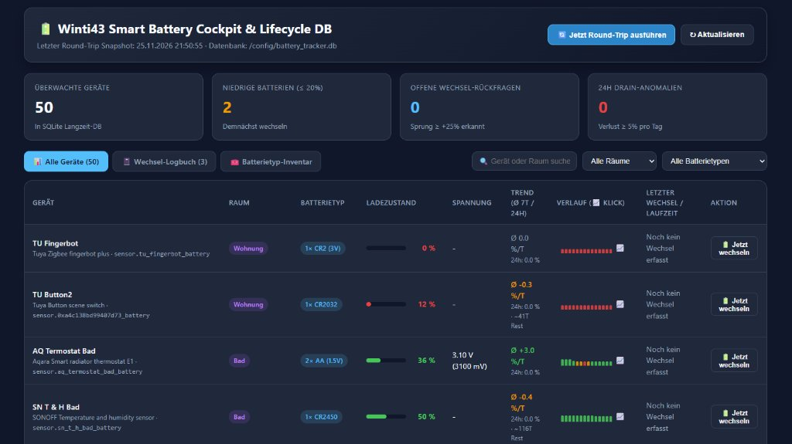
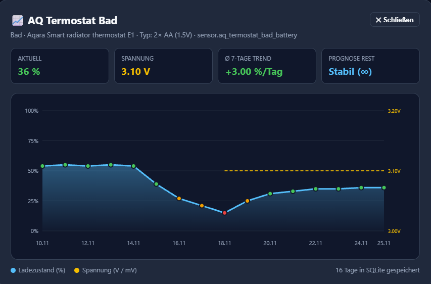

# 🔋 Smart Battery Cockpit for Home Assistant

A **zero-YAML, SQLite-backed Battery Lifecycle & Telemetry Cockpit** for Home Assistant.

Unlike standard battery cards that only show the current percentage and lose history after Home Assistant's 10-day recorder purge, **Smart Battery Cockpit** keeps a permanent, lightweight SQLite database of every battery-powered device in your home — with automatic swap detection, glitch filtering, drain anomaly alerts, and interactive 90-day line charts.

---

## 📸 Screenshots

### Main Cockpit Overview

### Interactive 90-Day Device Line Chart (Charge `%` + Voltage `V`)
> *Real-world example below: On Nov 15 an integration update caused a rapid Zigbee polling drain on `AQ Termostat Bad` (55% → 15%). After fixing the polling bug on Nov 18, the chart immediately captured the battery resting-voltage recovery back to 36%!*

---

## ✨ Key Features

- **🗄️ Permanent SQLite Lifecycle Database:** Stores daily battery `%` and voltage (`mV`) snapshots permanently in `/config/smart_battery_cockpit.db` — completely independent of Home Assistant's 10-day recorder purge.
- **📲 Human-in-the-Loop Battery Swap Detection:** Detects rapid upward jumps (default: `≥ +25%` to `≥ 80%`) and sends an **interactive mobile notification** (`✅ Yes, replaced` / `❌ No, false alarm`). Only confirmed swaps are recorded in your swap logbook and cycle-lifetime statistics.
- **🛡️ Built-in SQLite Baseline Glitch-Filter:** Automatically ignores transient firmware/ADC dips (such as sensors that briefly report `0%` for one check-in before bouncing back to `100%`) by cross-checking against the device's recent daily SQLite baseline.
- **🚨 Smart Drain Anomaly Detection:** Calculates a 7-day rolling drain rate (`%/day`) and remaining-days forecast (`est_days_left`), alerting you early when a misbehaving integration or Zigbee loop starts draining a battery abnormally fast.
- **📈 Interactive Web Cockpit (Built-in Sidebar Panel):**
  - Searchable & filterable table (by Room and Battery Type) with 14-day mini sparklines.
  - Click any device or sparkline to open an **interactive 90-day SVG Line Chart** showing **Battery `%`**, **Voltage (`V / mV`)**, and **green vertical Battery Swap markers** with hover tooltips.
  - Dedicated **Swap Logbook** and **Battery Type Inventory** (`AA`, `AAA`, `CR2032`, `CR2450`, `CR2`, etc.).
- **⚡ 1-Click UI Setup (`Config Flow`):** Zero YAML configuration, zero hardcoded tokens, native Home Assistant WebSocket API, and full **English & German** translations.

---

## 🚀 Installation

### Option 1: HACS / Home Assistant Marketplace (Recommended)
1. Open **HACS** in Home Assistant.
2. Click the **3 dots (`⋮`)** in the top right → **Custom repositories**.
3. Add `https://github.com/AndreasConradCH/ha-smart-battery-cockpit` with category **Integration**.
4. Search for **Smart Battery Cockpit** and click **Download**.
5. Restart Home Assistant.
6. Go to **Settings → Devices & Services → Add Integration → Smart Battery Cockpit** and complete the 1-click setup dialog!

### Option 2: Manual Installation
1. Copy the folder `custom_components/smart_battery_cockpit` into your Home Assistant `/config/custom_components/` directory.
2. Restart Home Assistant.
3. Add the integration via **Settings → Devices & Services → Add Integration → Smart Battery Cockpit**.

---

## ⚙️ Configuration Options

All settings can be adjusted anytime via **Settings → Devices & Services → Smart Battery Cockpit → Configure**:

| Option | Default | Description |
| :--- | :---: | :--- |
| **Notification Service** | *(optional)* | Mobile app notify target (e.g. `notify.mobile_app_...`) for interactive swap confirmations. |
| **Daily Round-Trip Hour** | `3` *(03:00)* | Hour of day (0–23) for the automatic daily SQLite snapshot. |
| **Swap Jump Threshold (%)** | `25` | Minimum upward percentage jump required to trigger a swap confirmation question. |
| **Exclude Rechargeable Devices** | `True` | Automatically skips smartphones, laptops, tablets, and robot vacuums. |
| **Show Sidebar Panel** | `True` | Adds the **Battery Cockpit** (`mdi:battery-sync`) directly to your Home Assistant sidebar. |

---

## 📄 License

MIT License — created by [@AndreasConradCH](https://github.com/AndreasConradCH).
